# NOCTURNE — 暮色住宅

一个以「夜晚」为叙事线索的四页式 Three.js 交互别墅沙盘。桌面端为左侧信息面板 / 右侧 3D 沙盘分栏，移动端自动变为上方 3D 舞台、下方信息流。

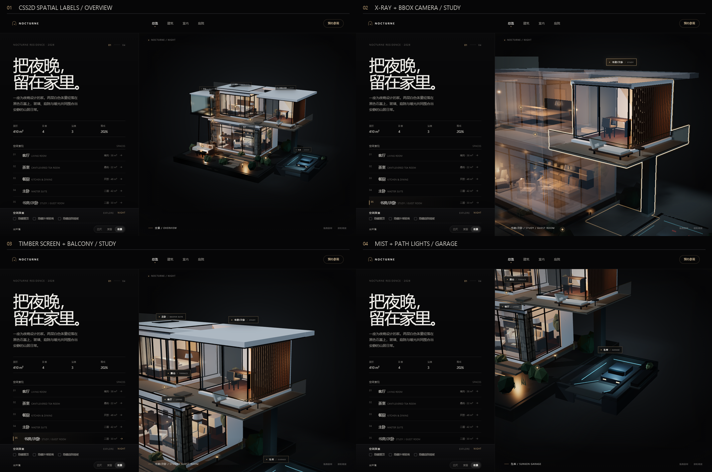

## 页面

| 页面 | 内容 |
| --- | --- |
| `index.html` | 总览：410 m² 轻质横向体量、书房/次卧、户外温泉、空间索引手风琴与光环境控制 |
| `architecture.html` | 建筑：文化石柱、悬挑屋面、玻璃幕墙、二层露台、爆炸图与剖面研究 |
| `interior.html` | 室内：客厅、餐厨、主卧、窗边 |
| `garden.html` | 庭院：草坪、户外沙发、夜行步道、灌木 |

四个页面共用同一套导航与 Three.js 场景。点击空间列表，相机会通过 GSAP 平滑飞到对应空间。

## 体量扩展与首层修正

- **左翼茶室** — 以 `THREE.Group` 组织的悬挑玻璃盒，围护使用 `MeshPhysicalMaterial({ transmission: 1, roughness: 0.1 })`；四根加粗的 `CylinderGeometry` 钢柱从独立柱脚向室内微倾，形成更明确的结构受力；盒内一盏暖色 `PointLight`。体块整体向主体推进 **0.5**，与二层白色楼板穿插。
- **右翼书房/次卧** — 完全移除原先的深色黑盒，替换为轻质二层体量：白色楼板、连续落地玻璃幕墙、后侧白色墙体；右侧是一列 `BoxGeometry` 暖棕木格栅，背后设置暖光扩散面与独立 `PointLight`，让灯光从缝隙间漏出。
- **环绕阳台** — 书房右侧与前侧延展出 L 形阳台，全部使用无框 `MeshPhysicalMaterial` 玻璃栏板、极细黄铜扶手与底槽；一张极简躺椅面向庭院，旧露台保留边几与种植槽，二者在同层连成连续户外平台。
- **屋顶延伸** — 主屋面以 L 形白色板继续向右悬挑，覆盖书房与新阳台；窄脊与主屋面咬合，保留旧露台的露天部分，并在外缘增加深色收边形成连续水平线。
- **下沉车库** — 贴住建筑右后侧；斜坡使用绕 X 轴旋转的 `BoxGeometry` 下行，两侧布置 `MeshBasicMaterial` LED；混凝土挡土墙、基础脊墙与首层传力梁延伸至书房楼板，使车库与右翼基础形成连续构造。
- **楼板层叠** — 二层主楼板、露台板、茶室传力板与书房楼板下增加深色收边条，形成阴影缝和体块穿插。
- **客厅交接** — 沙发整体上移到地面与地毯之上，新增一块深色 `BoxGeometry` 地毯遮盖交界；客厅相机改为前右视角。
- **相机** — `PerspectiveCamera` 默认机位进一步后移，`OrbitControls.maxDistance` 提升到 **64**，让扩展后的水平底座完整居中。

## 书房/次卧：可交互桌面与家具

书房特写机位面向桌面与后墙书架，书桌、显示器、键盘、台灯、书架和椅子全部计入 `study` 房间组，随 X-Ray 淡入淡出。

- **Mood PC / NOCTURNE OS** — 桌面显示器使用 640×360 的 HTML Canvas 映射为 `CanvasTexture`，默认为黑屏。点击显示器后，相机用 1.2 秒 `power3.inOut` 推近到屏幕，随后淡入 macOS Ventura 玻璃风格的全屏 `NOCTURNE // SYSTEM` 桌面：启动文字、银白进度条、玻璃窗口与右上角「返回别墅」按钮。相机 FOV 不变，OrbitControls 在点击瞬间禁用，3D Raycaster 在 OS 打开期间全部阻断。通过 Return 或 Escape 返回时，OS 淡出与相机 1.2 秒回程同时进行，动画结束后才重新启用 OrbitControls。OS 内的 Display Mode 仍控制三种 3D 屏幕模式：
  1. **Terminal** — 深色终端、绿色代码、固定的 `> INITIALIZE NOCTURNE...` 与滚动日志；屏幕 `PointLight` 切换为冷蓝白。
  2. **Music Visualizer** — 实时正弦条与波形；屏幕 `PointLight` 切换为暖紫 / 橙色。
  3. **Off** — 黑屏，屏幕灯光淡出到 0。
  屏幕动画使用独立的 `requestAnimationFrame` 循环，模式间的光色与强度由 GSAP 平滑补间。
- **Bookshelf** — 后墙水平书架，摆放多组低多边形彩色书籍；点击任意书籍或层板，层板下的暖色 LED 灯带与 `PointLight` 一起亮起。
- **Desk Lamp** — 独立暖光台灯，点击同时切换灯罩亮度、台灯 `PointLight` 和书房主 `PointLight` 的强度。
- **Rug & Chair** — 暖灰 `PlaneGeometry` 地毯；座椅包含四条腿、靠背和扶手。
- **Raycaster 优先级** — 点击时先对这三组交互家具做 Raycaster 检测；命中则处理家具，不再触发房间选择或误切换焦点。
- **机位** — 书房聚焦机位固定为正面偏右的桌面/书架构图；手机端根据 `fitFactor()` 自动后退。

### NOCTURNE OS / Desktop

OS 不再只是启动终端加控制面板，而是一套带启动动画的 macOS Ventura 玻璃桌面。主面板使用 `backdrop-filter: blur(20px)`、`rgba(255,255,255,0.05)` 背景、1px 半透明白边和分层柔和阴影；打开期间全屏 3D viewer 置于玻璃之后，使模糊层能真实采样别墅场景。字体切换为 SF Pro / Helvetica 无衬线体系，主文字 `#e0e0e0`、辅助文字 `#888888`、高光 `#f4f4f4`，不再使用金色、等宽字体、扫描线、颗粒或 CRT 暗角。

- **Boot → Desktop** — 进入后先显示 `NOCTURNE // SYSTEM` 启动页、启动文字和银白进度条；完成后以 0.8 → 1 的缩放淡入 Desktop。支持 `SKIP BOOT →`，全程仍保留右上角 Return。顶部窗口栏带红 / 黄 / 绿装饰性 traffic lights，不绑定关闭逻辑。
- **Dock** — Optical Glass 浮动岛：`HOME`、`PROJECTS`、`GALLERY`、`AUDIO`、`ENV`、`PLANS`。`border-radius: 99px`、`padding: 10px 20px`、`margin-bottom: 20px`，使用 `blur(30px) saturate(150%)` 和顶部 1px 高光，无硬边框。每项使用 SVG 图标 + 小号文字；hover 由 GSAP 做柔和浮起 / 放大。
- **Optical Glass cards** — Projects / Gallery 卡片与 OS 窗口使用 `rgba(255,255,255,0.03)`、`backdrop-filter: blur(30px) saturate(150%)`、28px 圆角和 1px 白色透光边。卡片内部 padding 32px；缩略图 20px 圆角 + 浮动阴影；主标题纯白、副标题 `#888888` 且 uppercase / 1px letter-spacing。
- **Pill actions** — `OPEN PROJECTS`、`VIEW GALLERY`、`OPEN GALLERY` 等操作按钮为 99px 圆角玻璃胶囊，`padding: 10px 24px`，GSAP hover 放大至 1.05。
- **Projects / Portfolio** — `portfolioData` 现在有 4 个真实条目：`NOCTURNE VILLA`（内部）+ `RAINY NIGHT / KONBINI`、`REFRESHMENTS`、`PERSONAL PORTFOLIO`。后三个来自同级项目文件夹，使用各自项目的真实截图和简介。
- **Pagination** — Projects 窗口每页 2 张 Optical Glass 卡片，顶部 `ALL PROJECTS / EXTERNAL / VILLA` 玻璃 segmented control，底部 `PAGE 01 / 02 · 2 PER PAGE` 与 `PREV / NEXT`；详情页沿用 `← BACK TO PROJECTS`。
- **External launch** — 外部详情页显示 `LAUNCH APP ↗`，通过 `window.open(url, "_blank", "noopener,noreferrer")` 打开：
  - Konbini — 复制到 `previews/konbini/` 的本地独立预览
  - Refreshments — `https://czhcyber.github.io/refreshments/`
  - Personal Portfolio — `https://czhcyber.github.io/learning-html/`
- **Live Preview** — 外部详情页可打开 iframe 模态：容器 `#000`、12px 圆角、1px 白色透光边，iframe 100% 铺满；`sandbox="allow-scripts allow-same-origin"`。左上角 `[ × ]` 或 Escape 关闭并清空 iframe。
- **Source isolation** — 除了把 Konbini 静态站复制到 `previews/konbini/` 作为隔离预览，没有修改任何其他项目文件夹；Refreshments / Personal Portfolio 只通过其 GitHub Pages URL 加载。缩略图分别来自 Konbini 自带 preview、Refreshments 首页截图、Personal Portfolio 首页截图。
- **Gallery** — 5 张从 3D 场景直接捕获的别墅渲染静帧，可按 `ALL / INTERIOR / EXTERIOR` 筛选；点击进入纵向大图 lightbox，支持上一张 / 下一张和 ESC 返回画廊。
- **Audio** — 四个独立 loop 轨道的播放器：`AMBIENT RAIN`、`WIND`、`JAZZ` 与本地文件 `Never See Me Again`；当前曲目、唱片视觉、播放 / 暂停、上一首 / 下一首、进度、音量与 MIX / QUEUE。四条音轨可同时叠混；`audioTracks` 跨 OS 会话保存，关闭 / 重开 OS 时继续播放。长音频文件使用 `preload="metadata"`，不阻塞首屏。
- **My Favourite / Record** — Audio 默认展示 `Never See Me Again`：260 × 260 px 方形封面 `images/blond.jpg`（`object-fit: cover`、12px 圆角、深阴影、细白边）、`Kanye West` 与 `MY FAVOURITE / RECORD` 标签；黑胶唱片从封面右侧露出，音频播放时旋转、暂停时停住，封面保持静止。音源位于 `music/Never See Me Again.mp3`。
- **Environment** — `NIGHT MODE` / `DUSK MODE` 只记录 pending 状态，不会立即改变 3D 场景。返回别墅且相机回程完全结束后才执行：Dusk 用 GSAP 把 `AmbientLight` 调暖、`scene.background` 调为暮色，并关闭客厅 / 卧室 / 阅读区 / 茶室 / 书房主灯与局部灯；Night 恢复原始照明、背景和灯光。`currentEnvMode` 跨会话保留。
- **Plans** — 保留 F1 / F2 内联 SVG 蓝图；可从 Dock 打开。蓝图、项目详情、Gallery lightbox 的 Escape 优先级都是“先返回上一层”，主桌面 Escape 才退出 OS。
- **Onsen / Garden Map** — 别墅左前方扩展出独立的户外温泉亭：黑石平台、木格栅、暖水池、石灯笼、竹屏、涟漪与蒸汽。可通过空间索引 `08 温泉`、3D 点击或 `GARDEN MAP` 进入；聚焦后右下角提供 `STEAM`、`BATH LIGHT` 和 `RETURN TO GARDEN`。`GARDEN MAP` 也可用 `M` 打开、`ESC` 关闭，包含 Villa / Tea Room / Terrace / Garage / Onsen 五个镜头节点。
- **Master Suite family photo** — 主卧床头墙新增 1.12 × 0.82 m 深木相框与 `PlaneGeometry(1,1)` 照片平面，读取根目录 `family.jpg` 并按原始宽高比自适应缩放。当前已放入用户提供的家庭照片；没有图片时显示深灰底与细金内框，不阻塞场景。鼠标悬停相框会出现手型光标，点击弹出文件选择器；上传图片通过 `FileReader` + `THREE.Texture` 热替换，旧纹理即时 `dispose()`。相框上方有一盏 `0.5` 强度的暖色 `SpotLight`，随卧室在 X-Ray Focus 中的变暗而渐隐到 `0.075`，退出聚焦后回到 `0.5`。
- **Layered Master Bed** — 床完全由原生 `BoxGeometry` 分层重建：2.2 × 0.3 × 2.0 m 床架、2.1 × 0.25 × 1.9 m 床垫、2.15 × 0.1 × 1.4 m 被子、两只 0.8 × 0.15 × 0.4 m 白色枕头与 2.4 × 0.8 × 0.15 m 床头板。左右各加一只原生 `BoxGeometry` 床头柜，左侧用 `CylinderGeometry` + `ConeGeometry` 组装台灯并内置 1.5 强度暖光；床下是 4.0 × 0.02 × 3.5 m 的深灰 matte rug。所有材质 `transparent: true`、初始 opacity 1，床架 / 床垫 / 枕头 cast / receive shadow。

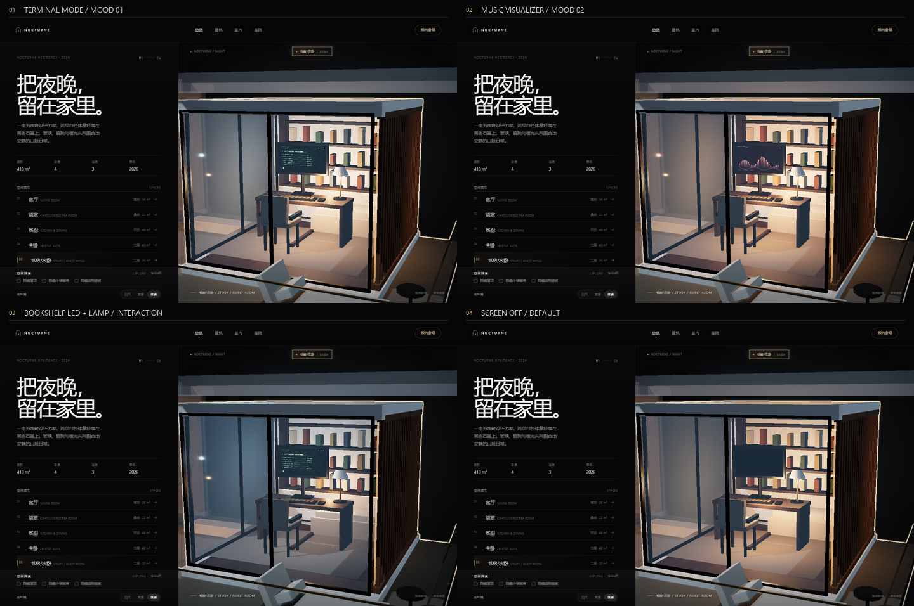

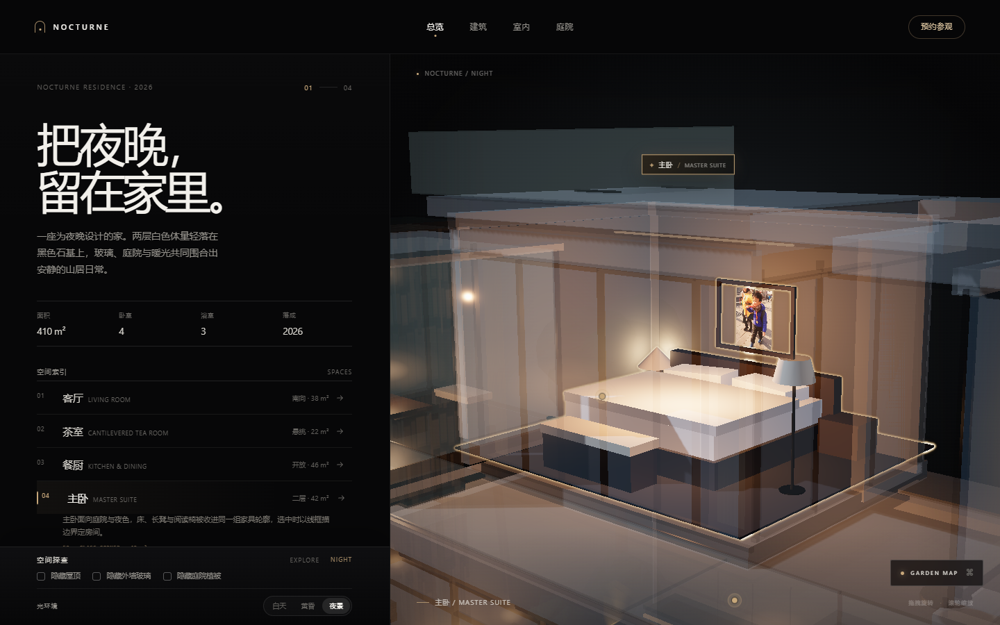

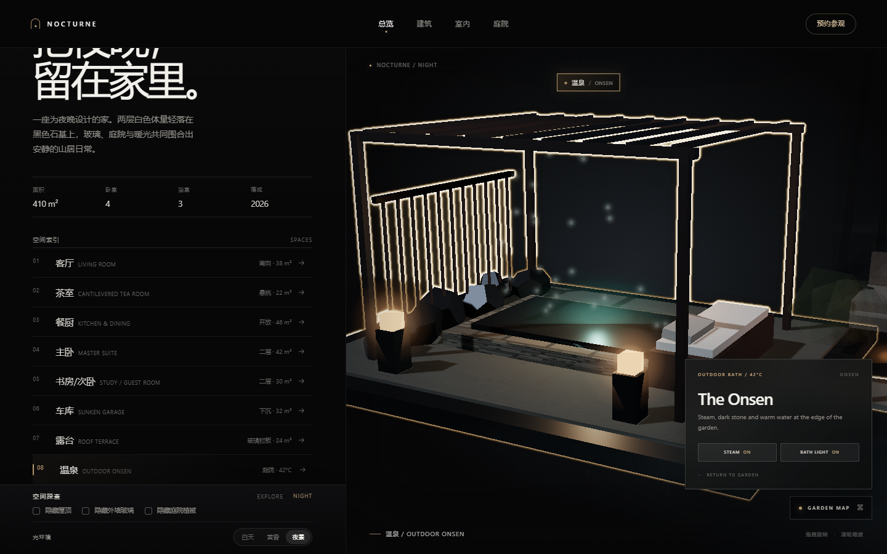

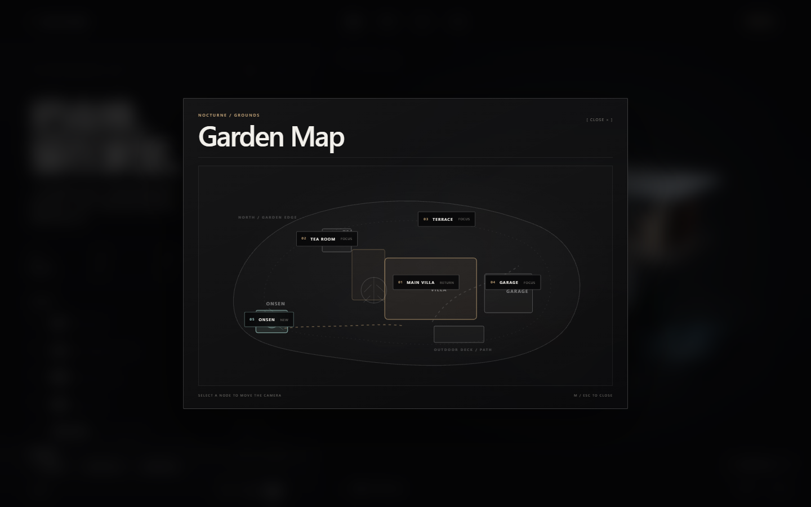

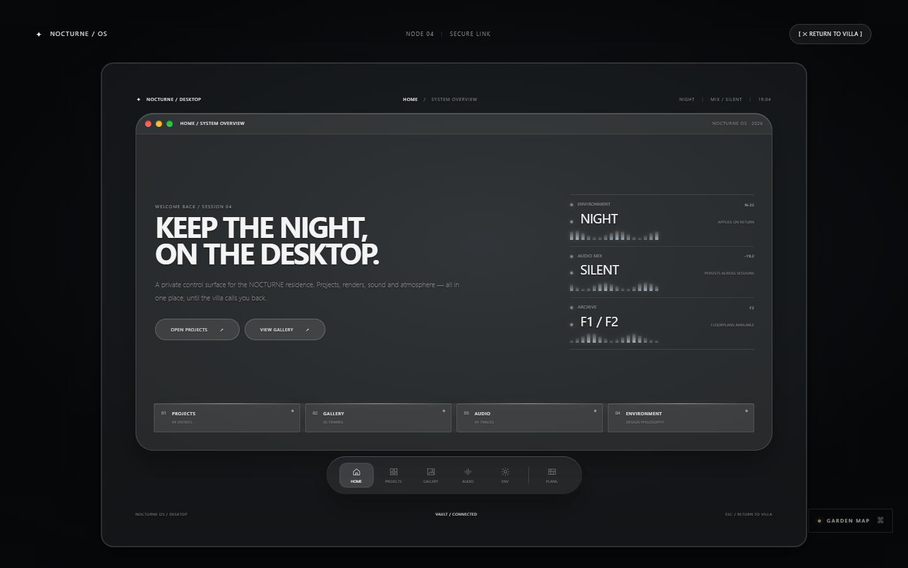

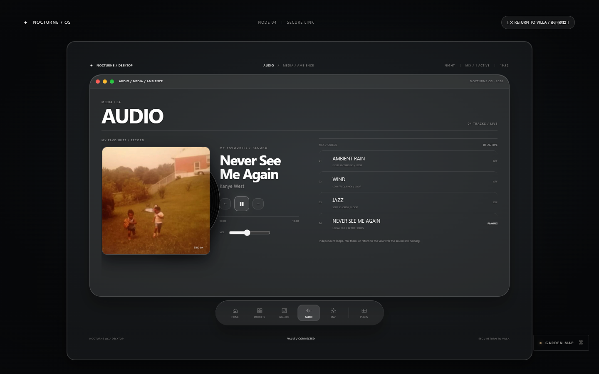

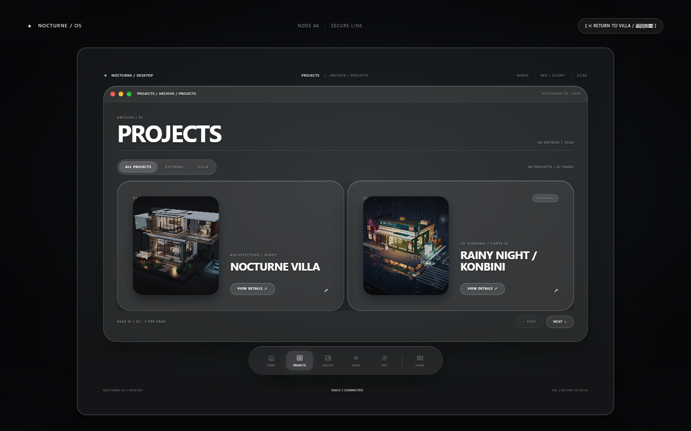

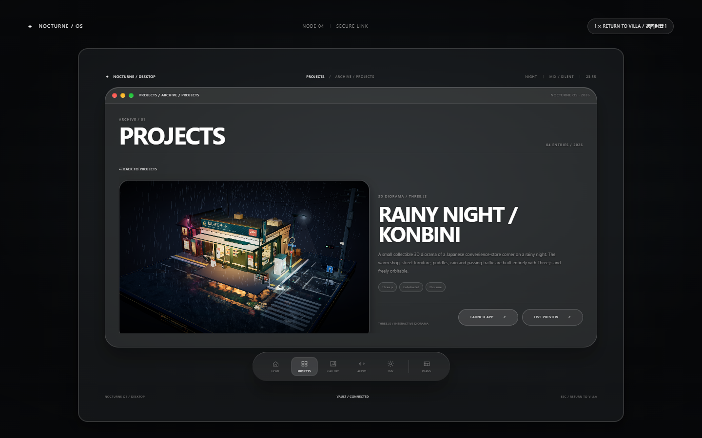

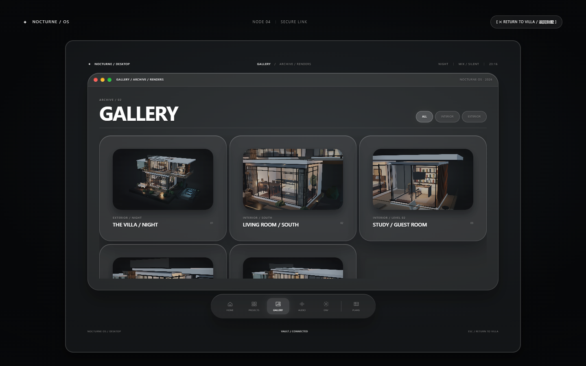

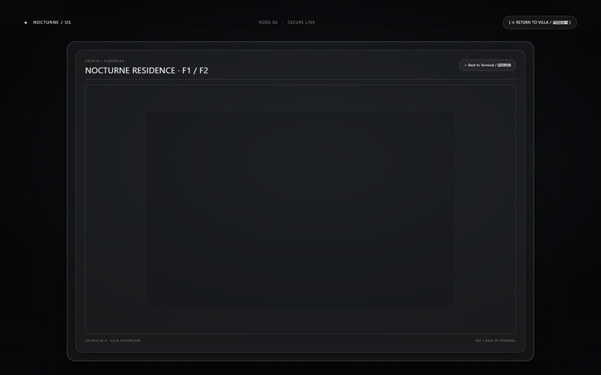

## 空间索引与 X-Ray Focus

总览页的空间索引已重构为八项手风琴：

1. 客厅 / Living Room
2. 茶室 / Tea Room
3. 餐厨 / Kitchen & Dining
4. 主卧 / Master Suite
5. 书房/次卧 / Study / Guest Room
6. 车库 / Sunken Garage
7. 露台 / Roof Terrace
8. 温泉 / Outdoor Onsen

点击条目会展开房间说明，并通过 GSAP 以 `power3.inOut` 同时插值 `camera.position` 与 `controls.target`。相机的目标点由选中房间的 `THREE.Box3` 包围盒计算，贴近房间的 1.5 秒电影式机位。也可以在 3D 视图中用 `THREE.Raycaster` 点击房间对应的模型。

### CSS2D 空间标签

- 使用本地 `vendor/jsm/renderers/CSS2DRenderer.js` 中的 `CSS2DRenderer` / `CSS2DObject`，在总览页为客厅、茶室、主卧、书房/次卧、露台、车库和温泉挂载深色磨砂玻璃标签。
- 标签带细金色描边、`✦` 标记和中文 / 英文双语名称；GSAP 以 `sine.inOut` 在 Y 轴轻微浮动。
- 标签会按到相机的距离缩放并按远距离降低不透明度；选中房间时，其他标签通过 GSAP 淡出。
- 标签是 DOM 元素，但点击处理会从标签屏幕位置发射 `THREE.Raycaster`，命中每个标签对应的隐形 3D proxy 后才触发房间聚焦，保证交互与 3D 场景一致。

进入 X-Ray Focus 后：

- 非选中房间与建筑构件的材质透明度补间至 **0.15**，并自动设为 `transparent = true`；
- 选中房间的材质先独立克隆，避免共享材质被一并压暗；
- `OutlinePass`（`vendor/jsm/postprocessing/OutlinePass.js`）描出选中 `THREE.Group` 的金色轮廓；
- 再次点击当前房间、切换光环境或使用图层控制都会退出聚焦。

### Garden Map 与温泉

- `Garden Map` 是独立于 3D 场景的 DOM 覆盖层，使用内联 SVG 平面图与绝对定位的玻璃节点；可点击 `MAIN VILLA / TEA ROOM / TERRACE / GARAGE / ONSEN` 直接调用现有 `selectRoom()` 或 `flyToView("overview")`。
- 地图不复制房间模型，也不新增渲染通道；打开时只暂停视觉焦点，关闭后仍由同一个 `THREE.PerspectiveCamera` 和 `OrbitControls` 控制。
- 温泉是 `state.roomGroups.onsen` 的 `THREE.Group`，由程序化 `BoxGeometry`、`PlaneGeometry`、`DodecahedronGeometry` 组成；没有外部模型或贴图。
- 水面使用 `MeshPhysicalMaterial`，蒸汽用带 `glowTexture` 的 `THREE.Points` 与自定义粒子漂移；涟漪是四个循环缩放的 `RingGeometry`。这些都在 `animate()` 内以时间驱动，不启动额外 RAF。
- 温泉 HUD 的 `STEAM` / `BATH LIGHT` 是真实状态开关，分别控制粒子可见性、池灯与水下辉光；`RETURN TO GARDEN` 退出 X-Ray Focus 并回到总览机位。

## 氛围与材质

- **基座雾** — 黑色基座上方叠加一张自定义 `ShaderMaterial` 雾面，使用 fbm 噪声和边缘衰减缓慢漂移；夜间约 0.085 的不透明度，白天自动降低。
- **路径灯呼吸** — 四盏草坪路径灯在入场后由 GSAP `sine.inOut` 持续微幅脉动，灯光光晕、地面光池与发光尺度同步变化。
- **木格栅高光** — 右翼书房木格栅 `roughness` 调整为 **0.4**，在夜间暖光下获得更细腻的木质高光。

## 空间探查（仅在总览页）

- **隐藏屋顶** — 移除顶层屋面，从上方看清二层卧室与室内布局。
- **隐藏外墙玻璃** — 移除玻璃幕墙与窗框，直接看到室内陈设与结构。
- **隐藏庭院植被** — 暂时收起所有庭院植物，突出建筑体量。
- **光环境** — 白天 / 黄昏 / 夜景三套预设；GSAP 对灯光颜色、强度、曝光和灯具自发光做平滑插值。

> 答辩话术：*Users can toggle building layers to peel off walls and roof for interior observation.*

## 空间标记 Hotspots

沙盘上有 6 个轻量圆点标记，随相机一起移动：

- **文化石柱** — 天然文化石饰面
- **二层露台** — 二层观景露台
- **户外沙发** — 庭院里的户外起居
- **主卧窗户** — 全景落地窗，引入庭院夜色
- **路径灯** — 点击依次点亮步道灯，再次点击重播
- **庭院灌木** — 点击召唤萤火虫，再次点击收起

鼠标悬浮、键盘聚焦或手机轻触圆点即可显示 tooltip；没有遮罩式弹窗。

## 环境触发 Hotspot Effects

- **路径灯** — 点击后四盏步道灯先清零，再按庭院纵深顺序由 GSAP stagger 逐一开启。
- **庭院灌木** — 点击后生成 96 个 `THREE.Points` 萤火虫，使用带 3D value noise 的顶点着色器漂浮、明灭；再次点击淡出。
- **三维涟漪** — 悬浮任意标记时，锚点表面出现一个由 `ShaderMaterial` 绘制的扩散涟漪环；移出或进入其它研究模式时停止。

## 建筑剖面研究（Architecture 页）

点击「悬挑屋面 / Cantilever Roof」或「玻璃幕墙 / Glass Curtain」会触发 **Exploded View**：

- 屋面、二层楼板 / 体量与露台板沿 Y 轴分层升起，使用 GSAP `power3.out` 缓动；
- 玻璃幕墙与窗框向外散开，露出被遮挡的楼板、结构与室内；
- 点击其他建筑章节或剖面控制台里的「闭合」恢复整体。

面板底部的「剖面研究」控制台提供：

- **蓝图模式 / BLUEPRINT** — 实体材质淡出为半透明蓝色线框，叠加蓝图网格与 X-Ray 发光。
- **动态剖面图** — 线条由 GSAP 绘制，标注 **24M SPAN**、**LOW-E GLASS**、**CANTILEVER 2.4M**、**STONE PIER**。

## 运行

页面使用 ES Module，需要通过本地 HTTP 服务访问（不能直接双击 HTML）：

```powershell
cd C:\Users\CZHaa\Desktop\github\nocturne-villa
python -m http.server 8901
```

然后打开 <http://127.0.0.1:8901/>。如果端口被占用，换成任意空闲端口即可。

## 交互

- 拖拽旋转沙盘 / 滚轮缩放
- 点击空间索引手风琴、CSS2D 房间标签或 3D 房间模型选择房间；相机以 `power3.inOut` 过渡
- X-Ray Focus 使用 OutlinePass 高亮选中房间，其他材质透明度降至 0.15
- 房间标签随距离缩放/淡出，聚焦时非选中标签淡出
- 基座雾缓慢漂移，路径灯持续呼吸
- 书房内点击显示器进入 NOCTURNE OS Desktop；通过 Dock 打开 Projects / Gallery / Audio / Environment，调整 Night / Dusk、混音与蓝图
- Night / Dusk 在返回别墅且相机回程结束后才应用；音频播放状态在 OS 开关之间持续
- OS 打开时 OrbitControls 与 3D 场景点击被锁定；Return 或 Escape 返回别墅，蓝图内 Escape 优先返回主桌面
- 总览页可切换图层与时间光照预设
- 建筑页支持爆炸图、蓝图模式与动态剖面
- 点击路径灯 / 庭院灌木标记可触发灯光序列与萤火虫
- 入场时由 GSAP 组装底座、建筑、室内、庭院、新翼与灯光

## 技术

- Three.js r187，`vendor/` 本地依赖，无需联网
- GSAP 3.13，本地依赖，用于相机过渡、爆炸图、图层淡出、灯光预设与焦点补间
- 体量均使用原生 `BoxGeometry` / `CylinderGeometry` / `PlaneGeometry` 与 `Group`
- CSS2D 标签使用本地 `CSS2DRenderer` / `CSS2DObject`；Raycaster 读取标签锚点的隐形 proxy
- 全程序化建模，约 **10,450 unique triangles**（透射玻璃的额外场景 pass 会计入约 24,800 的渲染吞吐），无外部贴图
- 书房 PC 使用动态 `CanvasTexture` + 独立 `requestAnimationFrame` 循环；家具点击与房间选择共用同一个 `Raycaster`，交互家具优先
- 全屏 NOCTURNE OS 使用 macOS Ventura 玻璃覆盖层、GSAP 相机推拉、自定义 GSAP 启动文字与 Desktop 窗口系统；打开期间 `Raycaster` 与 OrbitControls 均被状态锁阻断
- 玻璃外观：`backdrop-filter: blur(20px)`、`rgba(255,255,255,0.05)` 背景、`1px rgba(255,255,255,0.15)` 边框、分层阴影与 4px 银灰滚动条
- Vision Pro Optical Glass：OS 窗口与 Projects / Gallery 卡片使用 `blur(30px) saturate(150%)`、28px 圆角、32px 内边距、20px 圆角缩略图与 99px 胶囊按钮；Dock 为同材质的浮动玻璃岛
- 外部项目通过 `iframe` 隔离加载，不读取或合并其他本地项目源码；Launch App 使用新标签打开，Live Preview 关闭时把 `iframe.src` 重置为 `about:blank`
- 环境切换、Blueprint / Projects / Gallery 的窗口与 lightbox 过渡均由 GSAP 控制；三条环境音为运行时生成的本地 WAV data URI，`NEVER SEE ME AGAIN` 则直接加载本地 MP3，并只预取元数据
- 新增 `assets/gallery-*.png` 作为 Projects / Gallery 的内容静帧，由 3D 场景在浏览器中直接捕获，不参与 WebGL 材质贴图
- CSS2D 标签、基座雾与家具灯光均为本地 Three.js / GSAP 实现，无外部图像依赖
- `EffectComposer` + `RenderPass` + `OutlinePass` + `OutputPass`；只有 X-Ray Focus 时启用 composer，常规视图直接渲染
- 基座雾为自定义 `ShaderMaterial`，路径灯呼吸使用 GSAP sine tween
- 桌面端左右分栏；短屏自动压缩；手机端上下布局
- 静止时冻结阴影，爆炸 / 图层切换时按需刷新
- 萤火虫为单个 `THREE.Points` draw call；涟漪与萤火虫均使用原生 ShaderMaterial
- `sessionStorage` 记录入场状态；`prefers-reduced-motion` 下自动关闭动效
